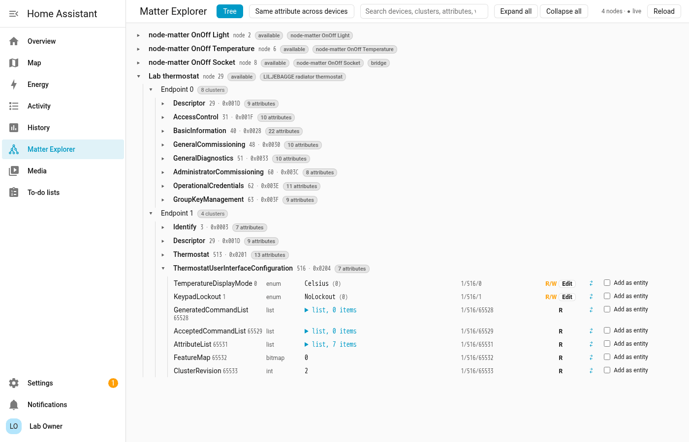
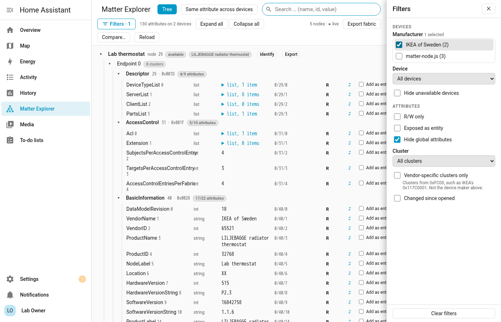
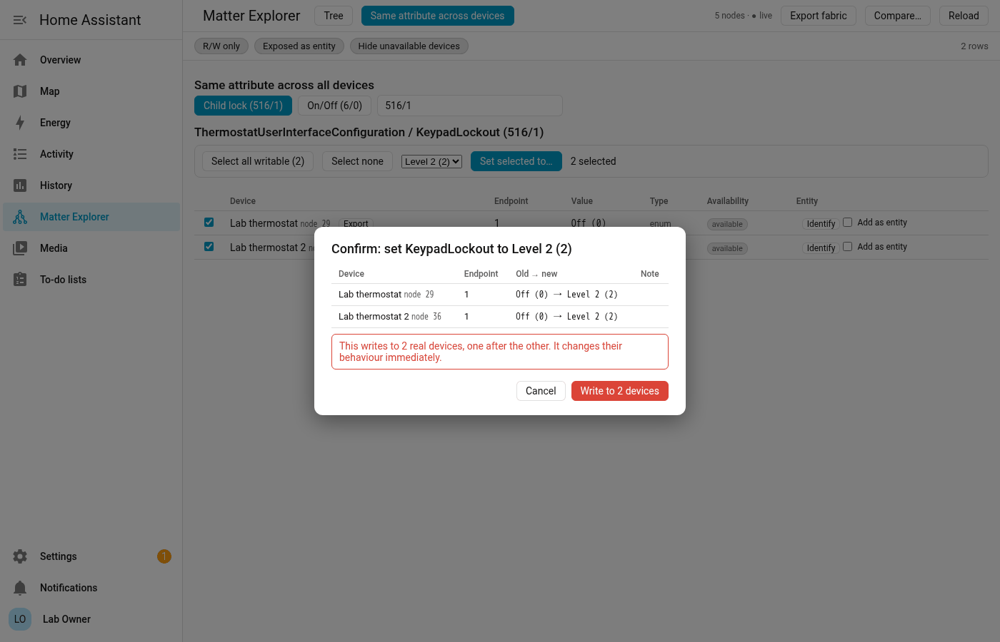
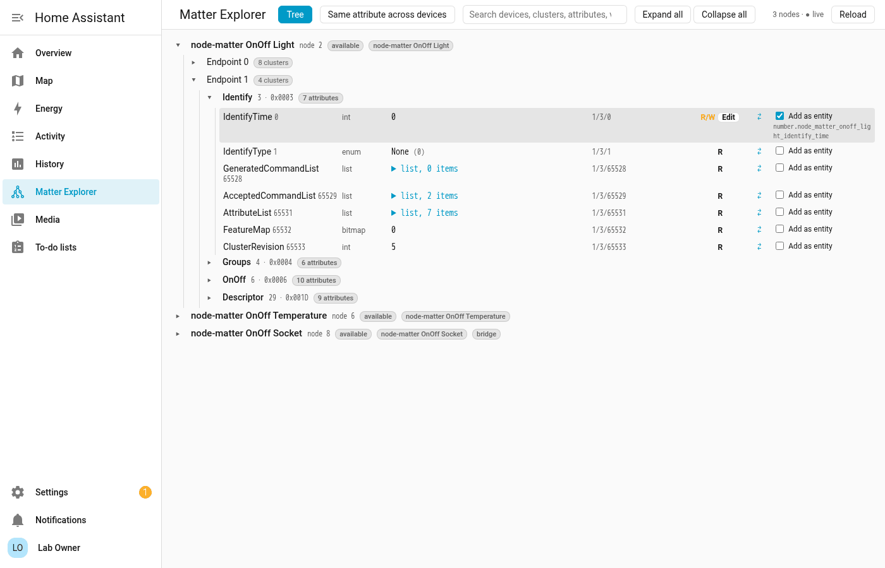
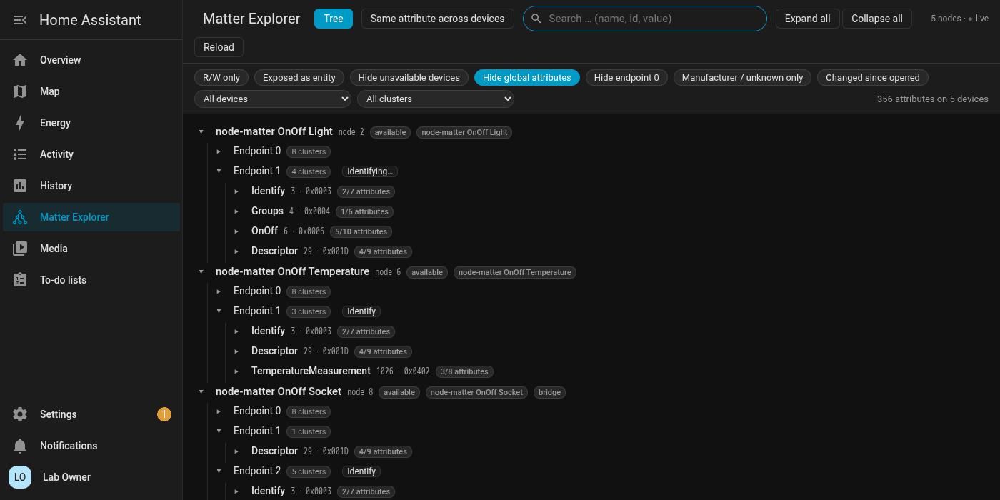
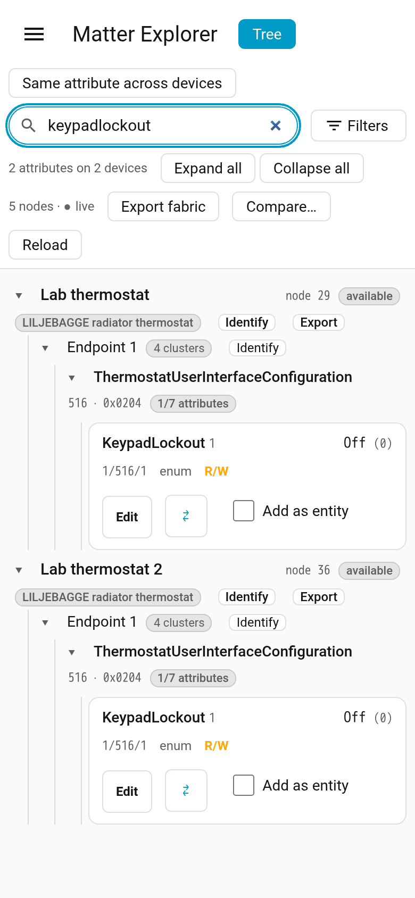

#  Matter Explorer

[](https://github.com/hacs/integration)
[](LICENSE)

A Home Assistant custom integration to **explore every attribute of every Matter device** on your fabric, and to
change a small, safe set of them.

Home Assistant's Matter integration only shows the entities it knows about. Plenty of useful settings are Matter
attributes that never become entities. The motivating example is the **child lock on the IKEA LILJEBAGGE radiator
thermostat**: it is the `KeypadLockout` attribute (cluster 516, attribute 1), and no HA entity controls it. With
Matter Explorer you find it in a tree, set it (with a confirm dialog and a read-back), and, if you want, expose it
as a normal HA entity ("Add as entity") so it works in automations and dashboards.

Matter Explorer reuses the connection of HA's own `matter` integration; it does not open another controller or
commission anything.



## Features
- **Browse everything:** device → endpoint → cluster → attribute, with value, type, read/write flag and spec
  names, updated live. Also a *Same attribute across devices* view and a card layout on phones.
- **Search and filter:** names, ids and values; a Filters side panel: manufacturer, device, cluster, R/W only,
  exposed, unavailable, global attributes, vendor-specific clusters, changed since opened.
- **Safe writes:** a small spec-based table of writable attributes (child lock, temperature display mode,
  setpoints, system mode, …), each behind a confirm dialog with read-back. Bulk write to many devices at once.
- **Add as entity:** turn an attribute into a switch, select, number, sensor or binary sensor on the existing
  Matter device.
- **Identify:** make a device blink or beep to tell physical devices apart.
- **Export and compare:** download one node or the whole fabric as JSON and compare it with an earlier export.
- **Diagnostics and repairs** for a bug report, and a repair issue when Matter is not loaded.

## Requirements
- Home Assistant **2026.11** or newer, with the **Matter** integration set up and connected to a Matter Server.
- An administrator account (the panel and its websocket commands are admin only).

## Install

### HACS (custom repository)
1. HACS → three dots → **Custom repositories**.
2. Add `https://github.com/kaptenQ/ha-matter-explorer` with type **Integration**.
3. Download **Matter Explorer**, restart Home Assistant.
4. Settings → Devices & services → **Add integration** → Matter Explorer.

### Manually
Copy `custom_components/matter_explorer` to `/config/custom_components/matter_explorer`, restart Home Assistant,
then add the integration as above.

## Usage
Admins get a **Matter Explorer** entry in the sidebar: browse device → endpoint → cluster → attribute, search
(names, ids, values), compare one attribute across all devices (⇄ on a row), with live updates.

### Filters and search
Press `/` to jump to the search box. The **Filters** button next to it (with a badge counting the active filters)
opens a side panel from the right (a sheet on a phone); the tree updates live, **Esc** closes it, **Clear filters**
sits at the bottom. The panel is grouped:
- **Devices:** **Manufacturer** (multi-select list of the makers present, from VendorName, else `Vendor 0x1234`; a
  bridged device uses its own maker if it reports one; **Unknown** is last; a count per entry; nothing selected means
  all), a **Device** select and **Hide unavailable devices**.
- **Attributes:** **R/W only**, **Exposed as entity**, **Hide global attributes** (ids from 0xFFF8, on by default),
  a **Cluster** select, **Vendor-specific clusters only** (clusters such as IKEA's 0x117C0001; not the device
  maker) and **Changed since opened** (attributes that got a live update since the page was opened).

All filters combine with the search. The header shows how many attributes on how many devices match. Filters and
the last search are remembered in the browser. The across-devices view offers Manufacturer, Hide unavailable, R/W
only and Exposed.



### Bulk write
In the across-devices view tick the rows (or **Select all writable**), pick one value and press **Set selected
to…**. A confirm dialog lists every device with old → new value, the rows already at the value ("no change") and
the rows that are skipped (unavailable, value outside that device's limits). Writes go out one after the other
with a short pause, a counter shows the progress, and the result lists match / mismatch / timeout / error per
device with **Retry failed**. Only attributes of the writable table can be bulk written.



### Expose an attribute as an entity
Every attribute row (also in the *Same attribute across devices* view, handy to tick the child lock on all
thermostats) has an **Add as entity** checkbox. Tick it and the entity appears on the existing Matter device;
its entity_id is shown next to the checkbox. New entities are named "<attribute> (Explorer)" so they do not
clash with the `matter` integration's entities (entities created by earlier versions keep their entity_id). Untick it and the entity is removed from the entity registry.
The ticked list is kept in the integration's options and survives restarts.

| Attribute | Entity |
|---|---|
| writable bool | switch |
| writable enum (child lock 516/1: Off, Level 1 … Level 5) | select |
| writable number with limits (setpoints in °C, step 0.5, the node's limits) | number |
| read-only bool | binary sensor |
| anything else read-only | sensor (unit and device class where known) |

Known enums show friendly labels in the panel and in the entities (child lock: Off, Level 1 … Level 5; the spec
name is the tooltip). On a phone every attribute is a card. Bridge endpoints show the bridged device's name, which
you can search for and pick in the Device filter. Escape clears the search box; a saved search or filters are
announced with a "restored" note.

Writable entities write only through the write gate (with read-back). Entities are unavailable while their node
is, and take their state from live attribute updates.



The websocket commands `matter_explorer/nodes` (full tree), `matter_explorer/subscribe` (live events),
`matter_explorer/write`, `matter_explorer/write_many`, `matter_explorer/set_exposed` and `matter_explorer/identify` are admin only.

**Identify button.** Endpoints with the Identify cluster get an *Identify* button (tree and across view) that
makes the device blink or beep for 15 s, to tell physical devices apart. It is the only command the explorer
sends, through a command gate with an allow-list of Identify (identifyTime 1-60 s) only.



### On a phone
Below 600 px every attribute is a card with 40 px touch targets.



## Safety
- **Read-only by default.** Browsing never writes anything.
- **Writes go through one gate** and only for attributes in a fixed, spec-based table (with their limits). The panel
  and the entities use the same gate.
- **Unknown and manufacturer clusters are never written**, whatever the device reports as writable.
- **Confirm and read-back.** Every write asks for confirmation (the bulk dialog shows old → new per device), is sent
  with a 30 s timeout, and the value is read back and compared; the result says match, mismatch, timeout or error.
- **The only command is Identify** (identifyTime 1-60 s), through a separate command gate with an allow-list.
- No commissioning, removal or firmware actions. All websocket commands are admin only.
- Try new things on a lab first, not on the devices you depend on.

## Troubleshooting

- **Repairs shows "Matter is not loaded".** Matter Explorer needs HA's own Matter integration to be loaded and
  connected to the Matter Server. The issue clears by itself when Matter is back; Matter Explorer entities are
  *unavailable* until then and recover without an HA restart. If it stays: check Settings > Devices & services >
  Matter and the Matter Server (add-on or container).
- **"device didn't answer within 30 s".** Writes and Identify wait 30 s for the device. Thread devices that sleep
  or sit behind a weak router may not answer; try again, or use Identify to see if it responds at all. If the
  answer arrives late, the value updates by itself.
- **The panel says "Reconnecting…".** The browser lost its connection to HA (restart, network). The panel
  subscribes again and reloads all values when the connection is back. If a bulk write was running, the dialog
  tells you how many writes were reported before the drop: check the values (the rows are refreshed).
- **"missing" items above the tree.** Ticked "Add as entity" items whose node or attribute no longer exists
  (removed device, changed firmware). Untick them there.
- **Download diagnostics** (Settings > Devices & services > Matter Explorer > the three dots) for a bug report: it
  has options, the exposed list, server info, counts and the last 20 write/command results, but no attribute dumps.

### Debug logging

```yaml
logger:
  default: warning
  logs:
    custom_components.matter_explorer: debug
```

Every write and Identify is logged at info (node, path, old and new value, read-back); failures at warning;
repeated warnings for the same item are logged once per 5 minutes (the repeats show at debug). Unexpected
errors are logged with their traceback.

## Development
`scripts/test.sh` runs ruff, mypy, pytest and the JS tests (Python 3.14). A disposable lab (Matter Server, Home
Assistant, matter.js sample devices; see `lab/docker-compose.example.yml`) is used for end-to-end checks:
`scripts/lab/bootstrap.py` sets it up, `scripts/lab-deploy.sh` deploys the integration into it, and
`scripts/lab/e2e.py <scenario>` drives it. See [CONTRIBUTING.md](CONTRIBUTING.md), [docs/DESIGN.md](docs/DESIGN.md)
and the redaction notes in [tests/fixtures/README.md](tests/fixtures/README.md).

## License
[MIT](LICENSE) © 2026 kaptenQ
